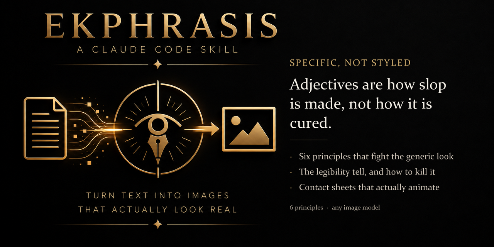

# Ekphrasis

**Adjectives are how slop is made, not how it is cured.**

An Agent Skill for Claude Code, Codex, Cursor, and other Agent-Skills-compatible tools.

---

## The gap this fills

Ask an agent for an image prompt and it will hand you a pile of style words. Cinematic, hyperdetailed, 8k, award-winning, stunning. The result is the glossy, weightless, faintly plastic picture everyone can now recognise at a glance and nobody wants.

The instinct is to add more adjectives. That is the mechanism causing the problem, not the fix for it.

A prompt that describes a **mood** leaves every concrete decision unspecified, so the model fills each gap with its most probable answer. The sum of most-probable answers is the mean of everyone's averages, and that mean is precisely the look you are trying to escape. More style words means more gaps filled by the average, not fewer.

Ekphrasis is the opposite move: specificity and constraint. Named for the classical practice of describing a visual work in words, it is prompt authorship rather than image editing.

| Approach | What comes back |
|---|---|
| Add style words | The average, more confidently |
| Ask for "photorealistic" | The average, shinier |
| **Name a subject, fix the light, restrict the medium, say what it is not** | **A picture that looks like someone made a decision** |

## The six principles

1. **Name a real subject with particularity.** Not "a forest" but *a stand of birches in November, one leaning against its neighbour, bark peeling in narrow strips.*
2. **Commit to one light source with a direction.** Slop lives in diffuse, directionless light.
3. **Say what the image is not.** No lens flare, no chromatic aberration, no soft-focus glow, no 8k.
4. **Restrict the medium explicitly.** "Colour photograph" drifts to commercial gloss. *Shot on 35mm film, mild grain, halation* does not.
5. **Give the composition a job.** Asymmetry, negative space, a quiet corner. Restraint reads as intention.
6. **Know what it is for before writing.** A cover, a mood board and a texture study want different prompts.

## The legibility tell

The most reliable giveaway that an image was generated, and the one almost nobody can name.

Image models are rewarded during training for text being *readable*. So they rotate documents, signs, books and labels flat-on to the viewer, at readable angles, in readable type, **even when nobody in the scene would arrange them that way**. The model is not reasoning about the scene's internal logic. It is arranging the world for the viewer's convenience.

It is the same mechanism that makes generated hands hold objects at those odd camera-facing angles.

The fix is not a cleverer instruction. It is removal, strongest first:

1. **Take the text out of the frame.** *A neat stack of folded papers bound by a rubber band, lying flat.* No text, no legibility pressure, no rotation. The meaning survives without visible words.
2. **If text must be readable, make it partial and incidental.** Never centred, never flat-on. Physics anchoring, like *half under a saucer*, makes rotation harder.
3. **Reduce the count.** One legible element is a target. Three is a cluster the model arranges like a display.
4. **Add a recessional instruction.** Helps, but unreliably, and it will not save you on its own.

## Animation that does not jitter

Generators draw each frame autonomously with no shared coordinate system. Frame 3's hand does not belong to frame 2's clock. The jitter is the model having no consistent geometry across frames.

So stop asking for frames. Ask for **one numbered contact sheet** with gutters, because inside a single image the model does hold geometry. Lock everything static identical across frames, change only the moving part, and move it along a discrete known sequence rather than "continuous motion". End on a rest frame identical to frame 1 so it loops.

Assemble at **6 to 8 fps, not 24.** Stop-motion reads better slow, and slow hides what is left.

## What it cannot do

- **Guarantee anything.** This is a strong tendency, not a law. A weak base model, anatomy collapse, or a platform's own post-processing can reintroduce slop no matter how good the prompt is.
- **Replace steering.** A generic first render is normal. Expect to follow up in words: *turn the stack so I see only its edge, push the jar further into shadow.*
- **Make you a photographer.** It removes the machine's defaults. What replaces them is your judgement.

One mechanism note, because getting it wrong will mislead you about what to change: models synthesise from a learned distribution. They do not retrieve stored images. Vague prompts pull the sample toward high-probability regions, and that is all "slop" ever was.

## Install

```
/plugin marketplace add Pr1m4lc0d3/ekphrasis
/plugin install ekphrasis
```

Or copy `skills/ekphrasis/` into your `.claude/skills/` folder.

No dependencies. It is a method, not a program.

## Related

- **[metaphrasis](https://github.com/Pr1m4lc0d3/metaphrasis)** — the same refusal applied to audio: measurement instead of a confident guess about how something sounds.
- **[paraphrasis](https://github.com/Pr1m4lc0d3/paraphrasis)** — carrying a claim to a new audience without letting the claim drift.
- **[peitho](https://github.com/Pr1m4lc0d3/peitho)** — the prose counterpart. Both are about refusing the most probable phrasing.

## Where this came from

Distilled from a working conversation with an artist agent running in [Chatterbot 2000](https://chatterbot2000.com), which wrote the method down for itself after enough rounds of looking at what came back. The legibility tell is its observation, not mine.

Built alongside [Deliberon](https://deliberon.com

Also on Agensi, if you would rather install it in one step and have it keep itself
updated: https://www.agensi.io/skills/ekphrasis-image-prompts-that-are-not-obviously-ai).

## License

Not open source. All rights reserved. See [LICENSE](LICENSE).

Licences are sold: https://www.agensi.io/skills/ekphrasis-image-prompts-that-are-not-obviously-ai
